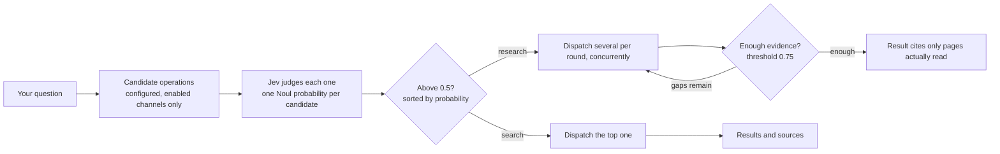

<div align="center">


# Smart Search

### Let your AI search the web, read the original pages, and answer with sources you can check

**You pick the providers and bring the keys. Jev decides which channel each question should go to.**

[简体中文](README.zh-CN.md) | English

[](https://www.npmjs.com/package/@konbakuyomu/smart-search)
[](https://github.com/konbakuyomu/smartsearch/actions/workflows/ci.yml)
[](https://github.com/konbakuyomu/smartsearch/releases/latest)
[](https://nodejs.org/)
[](#supported-ai-tools)
[](https://github.com/konbakuyomu/smartsearch/blob/main/LICENSE)

[Download the App](https://github.com/konbakuyomu/smartsearch/releases/latest) · [User guide](https://github.com/konbakuyomu/smartsearch/tree/main/docs/guide) · [Jev routing](https://github.com/konbakuyomu/smartsearch/blob/main/docs/jev-routing.md) · [Report a problem](https://github.com/konbakuyomu/smartsearch/issues)

[See it](#see-it) · [Quick start](#quick-start) · [Everyday use](#everyday-use) · [How it works](#how-it-works) · [Providers](#capabilities-and-providers) · [Commands](#common-commands) · [FAQ](#faq)

<code>npm install -g @konbakuyomu/smart-search@latest</code>

</div>

<br>

<p align="center">
  
</p>
<p align="center"><sub>The same question, asked with the built-in search (left) and with Smart Search (right): Jev scores every configured channel and dispatches only the highest one above the threshold. The numbers shown are examples. Animations are in Chinese.</sub></p>

> [!IMPORTANT]
> Smart Search does not provide search itself. Searching and page reading are done by the providers you choose, with API keys you supply, saved in your local configuration folder. Provider tests and searches may use those providers' paid quota; opening the App or checking the local environment never runs a paid search.

## What it is

Smart Search puts search, page reading and provider configuration in one place and connects them to AI tools such as Codex, Claude Code and Cursor. It has three parts:

| Part | What it does |
| --- | --- |
| **Independent CLI** (`smart-search`) | Runs searches, page reads and live research; your AI goes online through it |
| **Desktop App** (Windows / macOS) | Installs the CLI, configures providers, updates Skills, searches and shows activity |
| **Skills** | Instructions installed into your AI tools that tell them when and how to call the CLI |

The App only manages; after you close it, your AI keeps calling the CLI as its Skill describes.

It helps when you are:

- **Working with a library or API:** find current documentation and read the relevant pages.
- **Following recent changes:** look up announcements or news newer than a model's knowledge.
- **Checking a claim:** find its source, read the page, and compare it with other evidence.
- **Researching a larger question:** collect sources over several rounds, inspect gaps, and build a cited answer.

## See it

<table>
  <tr>
    <td width="50%" valign="top">
      
      <p><b>Ask your AI</b><br><sub>Say three things: use Smart Search, read the relevant page, give the sources. The AI searches, reads the original page and cites it.</sub></p>
    </td>
    <td width="50%" valign="top">
      
      <p><b>Configure a provider in the App</b><br><sub>Pick a provider, paste its key, test it (one real request), then save.</sub></p>
    </td>
  </tr>
  <tr>
    <td width="50%" valign="top">
      
      <p><b>Search in the App</b><br><sub>On Search &amp; research, pick a tool and enter a question; the result comes with its source links, ready to copy or export.</sub></p>
    </td>
    <td width="50%" valign="top">
      <p><b>The full videos</b></p>
      <sub>The feature film, the setup tutorial and the everyday-use tutorial are <a href="#full-videos">below</a>. All three are rendered frame by frame from code; their sources are in <a href="promo/"><code>promo/</code></a> and can be rebuilt locally.</sub>
      <br><br>
      <sub>Clawd in the animations is an unofficial fan depiction, not affiliated with Anthropic. The App screens are a redrawn illustration of the Windows App, with text taken from its source.</sub>
    </td>
  </tr>
</table>

### Full videos

The captions are in Chinese.

**The feature film, “The Same Question”** (53 s): the same question asked with the built-in search and with Smart Search, side by side: Jev routing, search, reading the original page, and an answer with sources.

https://github.com/user-attachments/assets/8909f8b9-394b-4617-b6bb-3c8b6904efc6

**Setup tutorial** (69 s): the Windows App page by page: install the CLI, add and test an API key, turn on Jev routing, update Skills.

https://github.com/user-attachments/assets/d2b17aea-1abe-4658-808a-1f212649e5e1

**Everyday use** (62 s): ask your AI directly, search and research in the App, read Activity, the common commands, and keep working after closing the App.

https://github.com/user-attachments/assets/915cb409-e012-4aa4-8910-3d213f732386

## Quick start

### With the App (recommended)

1. **Install the App and the CLI.** Download the package for your system from [Releases](https://github.com/konbakuyomu/smartsearch/releases/latest). Step 1 on **Overview** finds npm on your machine (or takes a manual path); **Install CLI** installs and connects the independent CLI. On Windows with a WSL distribution, each environment gets its own button: **Install in Windows** and **Install in WSL &lt;distribution&gt;** (WSL needs Node.js 18 or later).
2. **Configure providers.** On **Providers**, choose one provider each for main search, documentation search and page fetching, enter its API key, click **Test**, then **Save changes**. Each provider has a **Get API key** link. One working retrieval channel is enough to search; with all three, routing has more channels to choose from.
3. **Turn on Jev routing (optional).** Under **Providers → Intent routing**, enter a TypeSafe API key. The router mode defaults to **JEV semantic routing**; without a key, channels are chosen by local rules.
4. **Connect your AI tools.** On **Update Skills**, select your Agents (Codex, Claude Code and Cursor are selected by default) and click **Update selected Skills**. Files that differ are backed up first and extra files are kept. Reopen your Agent session and start asking.

Page-by-page instructions: [Set up and use the App](https://github.com/konbakuyomu/smartsearch/blob/main/docs/guide/en/app.md).

### Terminal only

```sh
npm install -g @konbakuyomu/smart-search@latest
smart-search setup          # terminal wizard; smart-search ui opens a local configuration page instead
smart-search doctor --format json
```

The npm CLI needs only Node.js 18+. Its platform package includes the Python runtime and does not use a user-installed Python. For a uv source installation or a fixed Python version, see [CLI installation](https://github.com/konbakuyomu/smartsearch/blob/main/docs/guide/en/cli.md#cli-installation).

## Everyday use

**In your AI tool:** ask naturally, for example:

> Use Smart Search to find the current React documentation for useEffect cleanup. Read the relevant page and include the source.

> Use Smart Search to check the claims in this page: https://example.com/article

| You say | It does |
| --- | --- |
| "Look up the current docs for X" | `search`: Jev picks one channel, which returns results and sources |
| "Read this link" | `fetch`: reads the page as clean text |
| "Check this claim" | Finds the source, `fetch`es the original, cites the pages it read |
| "Research X in depth" | `research`: several rounds of retrieval and reading; Jev judges each round whether the evidence is enough |

**In the App:** open **Search & research**, choose a tool (Search, Read page, Live research and more), enter a question or URL, and read the result and its **Source links** on the right; copy or export it. **Activity** shows each task's status, phase and provider, including tasks your AI started from the terminal.

**Language:** the App follows your system by default; choose Chinese or English in **Settings & about → Interface language**. The CLI keeps its own language preference and accepts a one-command `--lang en` / `--lang zh`. These settings change the interface and messages, not the text of a source page.

## How it works

The default intent router is **Jev semantic routing** (`SMART_SEARCH_INTENT_ROUTER=jev`); the judgments come from TypeSafe's Jev model:



- **The program lists the candidates; Jev only chooses.** Each candidate carries its provider, operation, capability, the actual query or URL, and your preference order, never a channel key. Jev does not write free-form queries or make tool calls.
- **search routes once.** It picks one suitable channel and returns results and sources, without sufficiency assessment, follow-up searches, filtering or synthesis; its `evidence_assessment.status` is `not_evaluated`. A successful retrieval is not a verified fact.
- **research follows the evidence gaps.** Each round Jev picks complementary actions that run concurrently, discovered pages are read, and the evidence is judged for a direct answer, detail, freshness, authority and corroboration. Only fetched or read text enters the citations.
- **It still works without Jev.** Without a TypeSafe key, or without a valid judgment, the default `--fallback auto` routes by local capability rules and marks the result as degraded; `--fallback off` fails instead. Explicit `local` mode never calls Jev.
- **Budgets are bounded.** Live research at quick / standard / deep allows at most 2 / 3 / 10 rounds and 1 / 2 / 10 channels per round, further limited by your Jev settings (3 rounds and 3 channels by default), and stops early once the evidence is enough.

The thresholds are a starting policy and do not guarantee a correct judgment. The full description, settings and output fields are in [Jev multi-channel routing](https://github.com/konbakuyomu/smartsearch/blob/main/docs/jev-routing.md) (Chinese).

## Capabilities and providers

One provider per capability is enough. Enter keys on the App's **Providers** page or save them with `smart-search config set`.

| Capability | Providers | What it does |
| --- | --- | --- |
| Main search | xAI, OpenAI-compatible API | A model searches the web and answers with citations |
| Documentation search | Context7, Exa | Library, API and official documentation pages |
| Web search | Zhipu, Zhipu Coding Plan, Tavily, TinyFish, DeepSeek, Firecrawl, Yuanbao Search | Discovers pages and excerpts |
| Page fetching | Jina, Firecrawl, Zhipu page reading, Tavily, TinyFish, DeepSeek | Reads a known URL as clean text |
| Vertical retrieval (experimental) | AnySearch, SciVerse | Domain and academic retrieval; SciVerse runs only when named explicitly |
| Intent routing (optional) | Jev (TypeSafe) | Scores candidate channels and routes |

## Supported AI tools

Skills can be installed for 17 targets: Codex, Claude Code, Cursor, OpenCode, GitHub Copilot, Gemini CLI, Cline, Roo Code, Kiro, Qoder, CodeBuddy, Factory Droid, Pi Agent, Kilo CLI, Antigravity, Windsurf and Hermes Agent. Install and sign in to the Agent applications yourself.

## Common commands

| Command | What it does |
| --- | --- |
| `smart-search search "question" --format markdown` | Ordinary search: one channel, results and sources |
| `smart-search fetch "https://…" --format markdown` | Reads a page as clean text |
| `smart-search research "question" --budget standard` | Live research: rounds of retrieval and reading, with evidence judgments |
| `smart-search deep "question" --budget standard` | Writes a research plan only; no network, no cost |
| `smart-search route "question"` | Previews routing locally without calling providers; `--remote` calls Jev (may be billed) |
| `smart-search doctor --format json` | Probes every configured provider with real requests |
| `smart-search setup` / `smart-search ui` | Terminal wizard / temporary local configuration page |
| `smart-search skills status` / `skills update` | Checks or syncs installed Skills |

All commands: [Complete command reference](https://github.com/konbakuyomu/smartsearch/blob/main/docs/guide/en/cli-reference.md).

## FAQ

<details>
<summary><strong>How many providers do I need?</strong></summary>

One working retrieval channel is enough to search. The App's **Check configuration** and Overview ask for main search, documentation search and page fetching; with all three, routing has enough channels to choose from and page reading has a dedicated fetcher.

</details>

<details>
<summary><strong>Does it work without a TypeSafe key?</strong></summary>

Yes. Jev is optional. Without a key, channels are chosen by local capability rules and the result is marked as degraded; you can also pick **Local routing** under **Intent routing**.

</details>

<details>
<summary><strong>Does it work with the App closed?</strong></summary>

Yes. Searches run in the independent CLI, which your AI calls as its Skill describes. If tasks the App started are still running when you close it, the App asks whether to **Continue in background** or **Cancel tasks and quit**; cancelling affects only the App's own tasks, never an external CLI.

</details>

<details>
<summary><strong>Does it cost money?</strong></summary>

Smart Search itself is free and open source. Provider tests, searches, `doctor` and `route --remote` call the services you configured and may use their quota. `route` without `--remote`, `deep` and opening the App never make paid requests.

</details>

<details>
<summary><strong>How is this different from an AI tool's built-in web search?</strong></summary>

You choose the providers and can configure several; Jev picks a channel for each question; and the pages behind an answer can be fetched and checked in full. The Skill tells the AI to use Smart Search alone for web research within a task instead of mixing routes.

</details>

<details>
<summary><strong>Windows shows SmartScreen; macOS cannot verify the developer</strong></summary>

Windows `-signed.exe` packages use a self-signed certificate and may still trigger SmartScreen; see [Windows signatures and first launch](docs/windows-signing.md). macOS release packages are signed with the maintainer's fixed self-signed certificate and use separate Sparkle EdDSA update signatures, without Developer ID signing or notarization; see [macOS signing](docs/macos-signing.md).

</details>

<details>
<summary><strong>How do the App and the CLI update?</strong></summary>

Separately. The App checks at each launch and asks in a dialog when a new version is out; you can also check under **Settings & about → App Updates**. It downloads only after you confirm. Update the CLI from **Overview → 1. Prepare local environment**, or run `npm install -g @konbakuyomu/smart-search@latest`. After an upgrade the CLI maintains connected Skills and preserves personal edits.

</details>

## Known limits

- A search hit is a lead. Read the source before relying on an important claim.
- Ordinary search does not assess evidence; use live research, or have your AI read the original page, when a claim needs checking.
- Jev's thresholds (0.5 for routing, 0.75 for sufficient evidence) are a starting policy and need calibrating against real questions.
- Availability, quota and result quality depend on each provider.
- Existing Inno installations need a one-time full migration. Final GUI and old-install migration acceptance is recorded separately from automated build and upgrade checks.

## Documentation

| Topic | Link |
| --- | --- |
| Set up and use the App | [docs/guide/en/app.md](https://github.com/konbakuyomu/smartsearch/blob/main/docs/guide/en/app.md) |
| CLI guide | [docs/guide/en/cli.md](https://github.com/konbakuyomu/smartsearch/blob/main/docs/guide/en/cli.md) |
| Providers and configuration | [docs/guide/en/configuration.md](https://github.com/konbakuyomu/smartsearch/blob/main/docs/guide/en/configuration.md) |
| Search, research and evidence | [docs/guide/en/research.md](https://github.com/konbakuyomu/smartsearch/blob/main/docs/guide/en/research.md) |
| Jev multi-channel routing | [docs/jev-routing.md](https://github.com/konbakuyomu/smartsearch/blob/main/docs/jev-routing.md) |
| Troubleshooting | [docs/guide/en/troubleshooting.md](https://github.com/konbakuyomu/smartsearch/blob/main/docs/guide/en/troubleshooting.md) |
| Development and releases | [docs/guide/en/development.md](https://github.com/konbakuyomu/smartsearch/blob/main/docs/guide/en/development.md) |

## Acknowledgements

Thanks to the [LINUX DO](https://linux.do/) community for its feedback and discussion.

[](https://www.star-history.com/#konbakuyomu/smartsearch&Date)

## License

Licensed under [MIT](https://github.com/konbakuyomu/smartsearch/blob/main/LICENSE). Clawd in the animations is an unofficial fan depiction of Anthropic's mascot, not affiliated with or endorsed by Anthropic.
