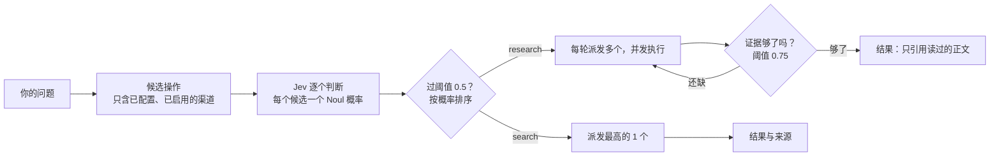

<div align="center">


# Smart Search

### 让 AI 联网查资料、读原网页，回答时附上能核对的来源

**服务商由你挑，Key 由你填；每个问题走哪个渠道，由 Jev 判断。**

简体中文 | [English](README.md)

[](https://www.npmjs.com/package/@konbakuyomu/smart-search)
[](https://github.com/konbakuyomu/smartsearch/actions/workflows/ci.yml)
[](https://github.com/konbakuyomu/smartsearch/releases/latest)
[](https://nodejs.org/)
[](#支持的-ai-工具)
[](https://github.com/konbakuyomu/smartsearch/blob/main/LICENSE)

[下载 App](https://github.com/konbakuyomu/smartsearch/releases/latest) · [使用手册](https://github.com/konbakuyomu/smartsearch/tree/main/docs/guide) · [Jev 选路说明](https://github.com/konbakuyomu/smartsearch/blob/main/docs/jev-routing.md) · [反馈问题](https://github.com/konbakuyomu/smartsearch/issues)

[看效果](#看效果) · [快速开始](#快速开始) · [平时怎么用](#平时怎么用) · [工作原理](#工作原理) · [服务商](#能力与服务商) · [命令](#常用命令) · [常见问题](#常见问题)

<code>npm install -g @konbakuyomu/smart-search@latest</code>

</div>

<br>

<p align="center">
  
</p>
<p align="center"><sub>同一个问题，左边是内置搜索，右边是 Smart Search：Jev 给每个已配置的渠道打分，只派发过线的最高一个。图中数值为示例。</sub></p>

> [!IMPORTANT]
> Smart Search 不提供搜索服务本身。搜索和读网页由你选择的服务商完成，API Key 由你提供，保存在本机配置目录。测试服务商和搜索可能消耗对应服务的额度；打开 App 或检查本机环境不会发起付费搜索。

## 这是什么

Smart Search 把搜索、读网页和服务商配置放在一起，接到 Codex、Claude Code、Cursor 等 AI 工具里。它由三部分组成：

| 部分 | 作用 |
| --- | --- |
| **独立 CLI**（`smart-search`） | 真正执行搜索、读网页、在线研究；AI 通过它联网 |
| **桌面 App**（Windows / macOS） | 安装 CLI、配置服务商、更新 Skills、在 App 里搜索和查看活动 |
| **Skills** | 写进 AI 工具的使用说明，告诉 AI 什么时候、怎样调用 CLI |

App 只负责管理；关掉 App 后，AI 仍会按 Skill 里的说明调用 CLI。

适合这些场合：

- **写代码、查 API**：找到当前文档，读与问题相关的页面。
- **了解新变化**：查公告和新闻，补上模型记忆里还没有的信息。
- **核对一个说法**：找到出处，读原文，再与其他来源对照。
- **研究复杂问题**：多轮收集资料，检查缺少的证据，整理带来源的回答。

## 看效果

<table>
  <tr>
    <td width="50%" valign="top">
      
      <p><b>在 AI 里直接问</b><br><sub>说清三件事：用 Smart Search 查、读相关页面、给出来源。AI 先搜索，再读原网页，回答里附上来源。</sub></p>
    </td>
    <td width="50%" valign="top">
      
      <p><b>在 App 里配置服务商</b><br><sub>选服务商、粘贴 Key，先测试（会发一次真实请求），通过后保存。</sub></p>
    </td>
  </tr>
  <tr>
    <td width="50%" valign="top">
      
      <p><b>在 App 里搜索</b><br><sub>「搜索与研究」页选工具、填问题，结果和来源链接一起给，可以复制或导出。</sub></p>
    </td>
    <td width="50%" valign="top">
      <p><b>三支完整视频</b></p>
      <sub>功能片、配置教程和日常使用的完整视频在<a href="#完整视频">下方</a>。三支都用代码逐帧渲染，源文件在 <a href="promo/"><code>promo/</code></a>，可在本地重新生成。</sub>
      <br><br>
      <sub>动画里的 Clawd 是非官方同人形象，与 Anthropic 无关；App 界面为 Windows 版的示意重绘，文字取自源码。</sub>
    </td>
  </tr>
</table>

### 完整视频

**功能片《同一个问题》**（53 秒）：同一个问题，内置搜索和 Smart Search 并排比较：Jev 选路、搜索、读原网页，最后给出带来源的回答。

https://github.com/user-attachments/assets/8909f8b9-394b-4617-b6bb-3c8b6904efc6

**配置教程**（69 秒）：跟着 Windows App 逐页配置：安装 CLI、填写并测试 API Key、打开 Jev 选路、更新 Skills。

https://github.com/user-attachments/assets/d2b17aea-1abe-4658-808a-1f212649e5e1

**日常使用**（62 秒）：在 AI 里直接问、在 App 里搜索和研究、查看活动、常用命令，关掉 App 也能继续用。

https://github.com/user-attachments/assets/915cb409-e012-4aa4-8910-3d213f732386

## 快速开始

### 用 App（推荐）

1. **安装 App，装好 CLI。** 在[发行页](https://github.com/konbakuyomu/smartsearch/releases/latest)下载适合系统的安装包。打开后，「概览」第一步会查找本机的 npm（也可以手动指定路径），点「安装 CLI」即可安装并连接独立 CLI。Windows 上有 WSL 发行版时，按钮按环境分开：「安装到 Windows」「安装到 WSL <发行版>」（WSL 里需要 Node.js 18 或更新版本）。
2. **配置服务商。** 打开「服务商」，为主搜索、文档检索、网页抓取各选一个服务商，填 API Key，点「测试」确认可用后「保存更改」。页面上有每家「申请 Key」的入口。最少配一个检索渠道就能用；三类都配上，选路时可选的渠道更多。
3. **打开 Jev 选路（可选）。** 在「服务商 → 意图路由」填 TypeSafe API Key。路由模式默认是「JEV 语义路由」；不填 Key 时会按本地规则选路。
4. **接入 AI 工具。** 打开「更新 Skills」，勾选你用的 Agent（默认是 Codex、Claude Code、Cursor），点「更新所选 Skills」。内容不同的文件会先备份，额外文件保留。更新后重新打开 Agent 会话，就可以开始问了。

逐页说明见 [App 配置与使用](https://github.com/konbakuyomu/smartsearch/blob/main/docs/guide/zh-CN/app.md)。

### 只用终端

```sh
npm install -g @konbakuyomu/smart-search@latest
smart-search setup          # 终端向导；也可以用 smart-search ui 打开本地配置页
smart-search doctor --format json
```

新版 npm CLI 只需要 Node.js 18+；平台包自带 Python 运行时，不使用你安装的 Python。用 uv 从源码安装或固定 Python 版本，见 [CLI 安装](https://github.com/konbakuyomu/smartsearch/blob/main/docs/guide/zh-CN/cli.md#cli-安装)。

## 平时怎么用

**在 AI 里**：直接告诉它要查什么，例如：

> 用 Smart Search 查 React 当前文档里 useEffect 的清理规则，读相关页面，并给出来源。

> 用 Smart Search 核对这篇文章里的说法：https://example.com/article

| 你说 | 它做 |
| --- | --- |
| 「查一下 X 的当前文档」 | `search` 由 Jev 选一个渠道检索，返回结果和来源 |
| 「读一下这个链接」 | `fetch` 把网页读成干净正文 |
| 「核对这个说法」 | 先搜到出处，再 `fetch` 原文，回答时引用读过的页面 |
| 「深入研究一下 X」 | `research` 多轮检索、读正文，Jev 每轮判断证据够不够 |

**在 App 里**：打开「搜索与研究」，选工具（搜索、读取网页、在线研究等），填问题或网页地址，结果和「来源链接」显示在右侧，可以复制或导出。「活动」页能看到每个任务的状态、阶段和用到的服务商，AI 在终端里发起的任务也会记在这里。

**切换语言**：App 默认跟随系统，可在「设置与关于 → 界面语言」选择中文或 English；CLI 单独保存语言偏好，也能用 `--lang zh` / `--lang en` 临时切换。这些设置只改变界面和提示，不翻译来源网页。

## 工作原理

默认的意图路由是 **Jev 语义路由**（`SMART_SEARCH_INTENT_ROUTER=jev`），判断由 TypeSafe 的 Jev 模型完成：



- **程序列候选，Jev 只做选择。** 候选包括服务商、操作、能力和实际的查询词或网址，以及你的偏好顺序；不包含任何渠道密钥。Jev 不生成任意查询，也不发起工具调用。
- **search 只选一次路。** 选一个合适的渠道，返回结果与来源；不做充分性评估、补搜、过滤或汇总，结果里的 `evidence_assessment.status` 是 `not_evaluated`。检索成功不等于事实已经核验。
- **research 按证据缺口继续。** 每轮由 Jev 挑互补的动作并发执行，读取发现的网页，再从直接答案、细节、时效、权威性、交叉验证几方面判断还缺什么。只有实际读过的正文会进入引用。
- **没有 Jev 也能用。** 没填 TypeSafe Key 或得不到有效判断时，默认（`--fallback auto`）按本地能力规则选路并标记降级；`--fallback off` 则直接报错。显式的 `local` 模式从不调用 Jev。
- **预算有上限。** 在线研究的 quick / standard / deep 上限分别是 2 / 3 / 10 轮、每轮 1 / 2 / 10 个渠道，同时受 Jev 设置约束（默认最多 3 轮、每轮 3 个渠道）；证据够了会提前停止。

阈值是初始策略，不保证判断一定正确。完整说明、配置项和输出字段见 [Jev 多渠道路由](https://github.com/konbakuyomu/smartsearch/blob/main/docs/jev-routing.md)。

## 能力与服务商

每类能力任选一家即可，Key 填在 App 的「服务商」页或用 `smart-search config set` 写入。

| 能力 | 可选服务商 | 做什么 |
| --- | --- | --- |
| 主搜索 | xAI、OpenAI 兼容接口 | 由模型联网搜索并回答，附引用 |
| 文档检索 | Context7、Exa | 查软件库、API 文档和官方页面 |
| 网页搜索 | 智谱、智谱 Coding Plan、Tavily、TinyFish、DeepSeek、Firecrawl、元宝搜索 | 发现网页和摘录 |
| 网页抓取 | Jina、Firecrawl、智谱网页阅读、Tavily、TinyFish、DeepSeek | 把已知网址读成正文 |
| 垂直检索（实验性） | AnySearch、SciVerse | 特定领域与学术检索；SciVerse 只在明确指定时调用 |
| 意图路由（可选） | Jev（TypeSafe） | 给候选渠道打分并选路 |

## 支持的 AI 工具

Skills 可以装进 17 个目标：Codex、Claude Code、Cursor、OpenCode、GitHub Copilot、Gemini CLI、Cline、Roo Code、Kiro、Qoder、CodeBuddy、Factory Droid、Pi Agent、Kilo CLI、Antigravity、Windsurf、Hermes Agent。Agent 软件需要你自己安装并登录。

## 常用命令

| 命令 | 作用 |
| --- | --- |
| `smart-search search "问题" --format markdown` | 普通搜索：选一个渠道，返回结果和来源 |
| `smart-search fetch "https://…" --format markdown` | 把网页读成干净正文 |
| `smart-search research "问题" --budget standard` | 在线研究：多轮检索、读正文、判断证据 |
| `smart-search deep "问题" --budget standard` | 只生成研究计划，不联网、不花钱 |
| `smart-search route "问题"` | 在本地预览选路，不调用服务商；加 `--remote` 才调用 Jev（可能计费） |
| `smart-search doctor --format json` | 逐个探测已配置的服务商，会发真实请求 |
| `smart-search setup` / `smart-search ui` | 终端向导 / 临时的本地配置页 |
| `smart-search skills status` / `skills update` | 检查、同步已安装的 Skills |

全部命令见 [完整命令参考](https://github.com/konbakuyomu/smartsearch/blob/main/docs/guide/zh-CN/cli-reference.md)。

## 常见问题

<details>
<summary><strong>最少要配几个服务商？</strong></summary>

至少一个可用的检索渠道就能搜索。App 的「检查配置」和概览页按主搜索、文档检索、网页抓取三类提示；三类都配上，Jev 才有足够的渠道可选，读原网页也有专门的抓取服务。

</details>

<details>
<summary><strong>不填 TypeSafe Key 能用吗？</strong></summary>

能。Jev 是可选的。没有 Key 时，默认按本地能力规则选路，结果里会标记为降级；也可以在「意图路由」里直接选「本地路由」。

</details>

<details>
<summary><strong>关掉 App 还能用吗？</strong></summary>

能。搜索由独立 CLI 执行，AI 按 Skill 里的说明直接调用它。如果关闭时还有 App 发起的任务在运行，App 会问你是留在后台继续，还是取消任务再退出；取消只影响 App 自己发起的任务，不会终止外部 CLI。

</details>

<details>
<summary><strong>会花钱吗？</strong></summary>

Smart Search 本身免费开源。服务商测试、搜索、`doctor` 和 `route --remote` 会调用你配置的服务，可能消耗对应额度。`route`（不加 `--remote`）、`deep` 和打开 App 都不会发起付费请求。

</details>

<details>
<summary><strong>和 AI 工具自带的联网搜索有什么不同？</strong></summary>

服务商由你选择，可以同时配置多家；每次搜索由 Jev 按问题挑渠道；回答所依据的网页可以抓下原文核对。Skill 会让 AI 在同一任务里统一使用 Smart Search，不混用别的联网途径。

</details>

<details>
<summary><strong>Windows 提示 SmartScreen，macOS 提示无法验证开发者？</strong></summary>

Windows 的 `-signed.exe` 安装包使用自签名证书，仍可能出现 SmartScreen 提示，详见 [Windows 签名与首次启动](docs/windows-signing.md)。macOS 包使用 ad-hoc 完整性签名和独立的 Sparkle EdDSA 更新签名，尚无 Developer ID 签名或公证。

</details>

<details>
<summary><strong>App 和 CLI 怎么更新？</strong></summary>

两者分别更新。App 在「设置与关于 → App 更新」检查并下载，确认后才下载；CLI 在「概览 → 1. 准备本地环境」更新，或运行 `npm install -g @konbakuyomu/smart-search@latest`。CLI 升级后会维护已接入的 Skills，并保留个人修改。

</details>

## 已知限制

- 搜索命中只是线索。重要结论请读来源正文，不要只凭摘要下判断。
- 普通搜索不做证据评估；需要核对时用在线研究，或让 AI 读原网页。
- Jev 的阈值（选路 0.5、证据充分 0.75）是初始策略，需要用实际问题校准。
- 服务商的可用性、额度和返回质量由服务商决定。
- 旧版 Inno 安装需要先完成一次完整迁移；最终的 GUI 和旧安装迁移验收单独记录，不由自动构建和升级检查代替。

## 文档

| 主题 | 链接 |
| --- | --- |
| App 配置与使用 | [docs/guide/zh-CN/app.md](https://github.com/konbakuyomu/smartsearch/blob/main/docs/guide/zh-CN/app.md) |
| CLI 使用指南 | [docs/guide/zh-CN/cli.md](https://github.com/konbakuyomu/smartsearch/blob/main/docs/guide/zh-CN/cli.md) |
| 服务商与配置 | [docs/guide/zh-CN/configuration.md](https://github.com/konbakuyomu/smartsearch/blob/main/docs/guide/zh-CN/configuration.md) |
| 搜索、研究与证据 | [docs/guide/zh-CN/research.md](https://github.com/konbakuyomu/smartsearch/blob/main/docs/guide/zh-CN/research.md) |
| Jev 多渠道路由 | [docs/jev-routing.md](https://github.com/konbakuyomu/smartsearch/blob/main/docs/jev-routing.md) |
| 排障 | [docs/guide/zh-CN/troubleshooting.md](https://github.com/konbakuyomu/smartsearch/blob/main/docs/guide/zh-CN/troubleshooting.md) |
| 开发与发布 | [docs/guide/zh-CN/development.md](https://github.com/konbakuyomu/smartsearch/blob/main/docs/guide/zh-CN/development.md) |

## 致谢

感谢 [LINUX DO](https://linux.do/) 社区的反馈和讨论。

[](https://www.star-history.com/#konbakuyomu/smartsearch&Date)

## 许可证

本项目采用 [MIT](https://github.com/konbakuyomu/smartsearch/blob/main/LICENSE) 许可。动画中的 Clawd 是 Anthropic 吉祥物的非官方同人形象，与 Anthropic 无关，也未获其认可。
