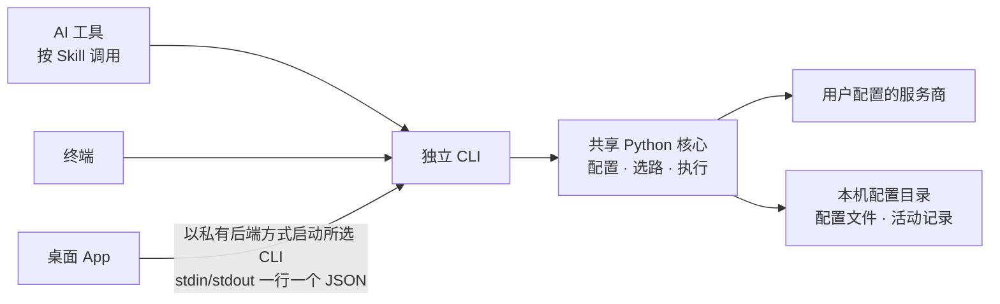

# Project Spec

> **读者：** 第一次进入项目的开发者——现在是什么、能做什么、从哪开始、边界在哪。
>
> 本页是全局地图，只写能在仓内文档或代码里找到出处的当前事实：文档出处见「想深入时」，代码落点见「证据索引」。子系统的细页改到哪里再补；目标全景归 Vision，尚未整理。

## 这个项目是什么

Smart Search 让 AI 联网查资料、读原网页，回答时附上能核对的来源。它自己不提供搜索：检索和读网页由用户挑选的服务商完成，Key 由用户自备，保存在本机的配置目录。

它由三部分组成，分别安装、分别更新：

- **独立 CLI**（`smart-search`）：真正执行搜索、读网页和在线研究，AI 通过它联网。
- **桌面 App**（Windows / macOS）：安装并连接 CLI、配置服务商、更新 Skills，也能直接搜索、查看活动。App 只做管理，关掉后 AI 照样按 Skill 调用 CLI。
- **Skills**：写进 AI 工具的使用说明，告诉 AI 什么时候、怎样调用 CLI；目前支持 17 个 Agent 目标。

仓里还有一个给 DeepSeek Harness 用的实验性插件包，边界见「边界与考量」。

服务两类人：普通用户装 App、填配置、看状态，不需要终端知识；开发者和 AI 工具使用者从终端或智能体调用 CLI，再从 App 观察进度、服务商和错误。产品的成功标准是：用户能完成配置、执行任务、看懂真实运行状态，App 没打开时照样能用 CLI。

## 一次使用怎样发生

图为当前的调用关系。三种入口最后都落到同一个 Python 核心：

- **在 AI 工具里**：用户自然提问，AI 按 Skill 调 CLI。查资料用 `search`（选一个渠道检索，返回结果和来源）；读链接用 `fetch`（把网页读成干净正文）；深入研究用 `research`（多轮检索、读正文、判断证据）；只要研究计划用 `deep`（不联网、不花钱）。
- **在 App 里**：按「概览」的顺序走——找到 npm，安装并连接 CLI；在「服务商」为主搜索、文档检索、网页抓取各配一个，测试后保存；可选在「意图路由」填 TypeSafe Key；在「更新 Skills」选 Agent 同步。之后在「搜索与研究」直接用，在「活动」里能看到包括 AI 从终端发起的任务。
- **只用终端**：`npm install -g @konbakuyomu/smart-search@latest` 之后，用 `smart-search setup`（终端向导）或 `smart-search ui`（临时的本地配置页）配置，再用 `smart-search doctor` 逐个真实探测已配置的服务商。

## 能力与选路

服务商按能力分组，每项能力配一个就能用；同一服务商可以兼有几项能力。

| 能力 | 做什么 | 可选服务商 |
| --- | --- | --- |
| 主搜索 | 由模型联网搜索并回答，附引用 | xAI、OpenAI 兼容接口 |
| 文档检索 | 查软件库、API 文档和官方页面 | Context7、Exa |
| 网页搜索 | 发现网页和摘录 | 智谱、智谱 Coding Plan、Tavily、TinyFish、DeepSeek、Firecrawl、元宝搜索 |
| 网页抓取 | 把已知网址读成正文 | Jina、Firecrawl、智谱网页阅读、Tavily、TinyFish、DeepSeek |
| 垂直检索（实验性） | 特定领域与学术检索 | AnySearch、SciVerse（只在明确指定时调用） |
| 意图路由（可选） | 给候选渠道打分并选路 | Jev（TypeSafe） |

选路的分工是「程序列候选，Jev 只做选择」：程序只把已配置、已启用的渠道列成候选，每个候选带服务商、操作、能力、实际查询或网址和用户的偏好顺序，不含密钥；Jev 给每个候选一个概率，不生成查询，也不调工具。

- `search` 只选一次路：派发过 0.5 的最高一个，不做充分性评估、补搜或汇总。检索成功不等于事实已核验。
- `research` 每轮并发派发几个互补渠道，只有真正读过的正文进入引用；证据判断过 0.75 就提前停。quick / standard / deep 三档最多 2 / 3 / 10 轮、每轮 1 / 2 / 10 个渠道，还受 Jev 设置约束（默认最多 3 轮、每轮 3 个）。
- 没有 TypeSafe Key 或拿不到有效判断时，默认按本地能力规则选路并把结果标为降级；也可以设成直接报错，或固定用本地路由，本地路由从不调用 Jev。
- 两个阈值是初始策略，还要用真实问题校准。

## App、CLI 与核心怎样分工

一套业务核心、多个兼容入口。配置、校验、选路和状态都由共享 Python 核心决定；App 不自己重算服务商能力、Key 是否有效、回退或冷却结果。

- **App 不带 CLI。** App 只分发原生界面和原生安装管理器，不带搜索引擎、Python 或 CLI。CLI 装在用户自己的 npm 里，App 通过所选的 npm 安装、修复、更新和卸载它，但不下载运行环境、不提权、不改全局 npm 配置或 PATH。Windows App 也能连接 WSL 发行版里的 CLI，配置、Skills 和活动记录归所选的那一边。
- **怎样连接。** App 用 `--desktop-backend` 启动所选 CLI，经标准输入输出交换一行一个 JSON 的私有协议（v1）；stderr 只做诊断，不开 HTTP 监听，不经 shell。兼容性靠 `--desktop-capabilities` 协商产品标识和协议版本，不要求两边版本号相同。
- **CLI 怎样分发。** npm 主包按精确版本的可选依赖，挑选 macOS、Windows、Linux 的 x64 或 arm64 平台包；平台包自带冻结的 Python 解释器和依赖，没有 postinstall，不回退到系统 Python。CLI 只要求 Node.js 18+；Linux 还要求 glibc 2.35+。
- **各自更新。** App 由 Sparkle（macOS）和 Velopack（Windows）更新，App 更新不会替换 CLI；CLI 自己检查 npm 上的新版本，只提示，不自动安装。
- **Skills 归 CLI 管。** 目标清单、正文、状态、安装、备份和移除都由 CLI 提供。装进 Agent 的是稳定的短入口，完整说明用 `smart-search agent-guide` 从当前 CLI 读取。
- **活动是共享的元数据。** CLI 和 App 把每次调用的命令、来源、阶段、服务商、耗时和结果状态写进配置目录里的活动记录，App 因此能看到 AI 从终端发起的调用。

## 界面（当前）

两端都是原生应用：Windows 用 WinUI 3 / C#，macOS 用 SwiftUI / Swift，有同样的六个工作区：概览、服务商、搜索与研究、活动、更新 Skills、设置与关于。概览是唯一完整的环境管理入口。结果先给可读正文和来源，原始 JSON 只放在高级展开里。App 默认跟随系统语言，可选中文或英文；CLI 有自己的语言偏好，也可以单次加 `--lang`。

## 统一语言

- **服务商 / 能力**：服务商是提供检索或读网页的第三方服务。能力是它被使用的方式，分主搜索、文档检索、网页搜索、网页抓取、垂直检索五类，外加可选的意图路由；按后端声明的能力归类，不按必填字段或是否已配置推断。
- **渠道**：某个服务商的某项能力；已配置、已启用时才成为选路候选。
- **兜底链**：同一能力内服务商的固定先后顺序，例如网页搜索从智谱排到元宝搜索。
- **意图路由 / 降级**：意图路由决定请求派给哪个渠道，默认是 Jev 语义路由，另有本地路由。没有有效的 Jev 判断、改按本地规则选路时，结果标记为降级。
- **有效配置**：每个配置项当前生效的值，来源是环境变量、配置文件或默认值之一；来自环境变量的字段在 App 里只读。
- **配置目录**：本机保存配置文件和活动记录的目录；App 可以切换，也可以恢复默认。
- **测试 / 用未保存的修改测试**：对点击时的有效配置（后者叠加草稿修改）发一次真实请求，结果不保存；草稿测试不能说成已保存配置通过了验证。
- **活动**：一次调用的元数据记录，来源是 App 或 CLI；运行中的记录随事件更新，不伪造完成百分比。
- **私有后端**：App 以 `--desktop-backend` 启动的 CLI 进程，只通过标准输入输出跟启动它的 App 通信；每个进程有新的 generation，旧进程的数据要丢弃。
- **自动维护**：CLI 在日常使用、版本变化后和此后每天检查已接入的 Agent 目标并更新 Skill，不需要 App 在运行，也不发网络请求；个人修改、缺失文件和未接入的目标都保留不动。

## 边界与考量

**做 / 不做**

- 不自带搜索。服务商测试、搜索、研究、`doctor` 和加 `--remote` 的 `route` 会调用服务商，可能消耗对方额度；打开 App、读取状态、检查本地环境、不加 `--remote` 的 `route` 和 `deep` 都不发计费请求。
- App 不终止外部 CLI 进程。关闭时如果 App 自己的任务还在跑，只提供后台继续、停止并退出或返回。
- 安装或移动 App 不会静默迁移、覆盖原配置；卸载 CLI 或 App 后，配置和 Skills 仍在。
- 实验性能力保持显式的实验性标识。
- Windows 与 macOS 分别验证，每版发版说明写明各自验证到哪一步。两端的签名都不等于系统默认信任：Windows 是自签名证书，macOS 没有 Developer ID 或公证。
- DeepSeek Harness 插件包是实验性的、独立的有界桥接：十个工具只调用公开 CLI 的 JSON 输出，不暴露配置、安装、凭据、选服务商、shell 或任意命令；DSH 凭据不会传进 Smart Search，也不给主包加 DSH 依赖。

**排除了什么**

- App 只读取所选 npm 的全局目录，不扫描、不接管 PATH 里 pip 或 uv 装的开发版；手动指定的路径无效时不回退到别的环境。
- codex-tweaks 只作结构和原生桌面体验的参考，不继承它的品牌、插件注入业务或全部实现。
- 更细的决定记在 `.agents/notes/`。

**长期质量约束**

- 兼容性：CLI 的命令、参数、别名、输出和退出码保持兼容；观测消息不进入 CLI 的业务标准输出。
- 功能适宜性（功能正确性）：状态要有来源和时间，未知不等于正常；活动只展示真实发生的阶段、耗时、尝试和失败，不伪造进度或健康状态。
- 信息安全性（保密性）：Key 不进通用状态、详情或诊断，Web 与 CLI 的状态输出保持脱敏；活动记录不含请求参数、查询内容、请求头或凭据。
- 可靠性（容错性）：操作失败不损坏旧配置；保存时遇到版本冲突，保留草稿并提示刷新。
- 交互能力（包容性）：遵循各平台的键盘导航、可见焦点、系统缩放和主题习惯；状态同时给文字，不能只靠颜色。

## 想深入时

- 产品为谁、守哪些原则 → `PRODUCT.md`
- 改桌面界面 → `DESIGN.md`（以 macOS 为主，末节是 Windows 适配）；Windows 的编译和视觉验收记录在 `docs/windows-ui-parity.md`
- 改 App、CLI 与 Skill 的分工，或安装、更新流程 → `docs/app-cli-boundary.md`
- 改原生客户端与后端之间的协议 → `desktop/PROTOCOL.md`
- 改选路 → `docs/jev-routing.md`
- 用户视角的完整说明 → `docs/guide/zh-CN/`（英文在 `docs/guide/en/`）
- 开发与发布 → `docs/guide/zh-CN/development.md`；每版说明在 `.github/releases/`

## 证据索引

| 想找 | 落点 |
| --- | --- |
| CLI 入口与命令 | `src/smart_search/cli.py` |
| 搜索、抓取、研究的执行，兜底链 | `src/smart_search/service.py` |
| 意图路由与 Jev | `src/smart_search/intent_router.py`、`src/smart_search/jev.py`、`src/smart_search/jev_search.py` |
| 各服务商的适配 | `src/smart_search/providers/` |
| 配置、字段元数据与状态 | `src/smart_search/config.py`、`src/smart_search/ui_metadata.py`、`src/smart_search/ui_api.py` |
| 临时本地配置页 | `src/smart_search/ui_server.py` |
| 桌面私有后端 | `src/smart_search/desktop_backend.py`，以及同目录 desktop_ 开头的模块 |
| 活动记录 | `src/smart_search/activity.py` |
| Skill 安装与维护 | `src/smart_search/skill_installer.py`、`src/smart_search/skill_maintenance.py` |
| Skill 正文 | `skills/smart-search-cli/`；打包副本在 `src/smart_search/assets/skills/smart-search-cli/`，`npm run check:skill-parity` 校验两份一致 |
| npm 启动器与平台包 | `npm/bin/smart-search.js`、`package.json` |
| 桌面 App | `desktop/windows/`、`desktop/macos/` |
| 打包、签名与发布 | `desktop/scripts/`、`.github/workflows/` |
| DSH 插件包（实验性） | `packages/smart-search-dsh/` |
| 测试 | `tests/`、`desktop/tests/` |
| 开发命令 | `mise.toml`、`package.json`、`pyproject.toml` |
